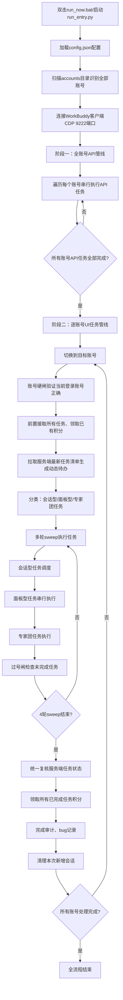

# WorkBuddy自动签到刷积分项目 代码深度核验报告
**核验基准**：`docs/19个成长任务完整执行流程图.html`（多轮真机验证最终版）
**核验时间**：2026-09-26
**核验方式**：只读追踪真实调用链，不修改代码，所有结论均有源码依据

---

# 2026-09-27 复核结论（最新，优先于下文历史问题清单）

## A. 全账号真机盘点（服务端只读）
- 配置共 **20 个账号**（account_a~account_t），数量正确。
- **19 个账号可自动化任务 16/16 全部 claimed**。
- **account_t 15/16**，唯一未完成项 `template_5=4/5`（差最后 1 个全新模板完整交付）。
- 两个免费模型频率限制：Hy3 2026-09-27 20:32:35 重置、Hy4 preview 2026-09-28 00:17:26 重置。
- 已启动自主收尾脚本 `_run_autonomous_finish.py`：睡到 20:34 → fire「未来玻璃产品落地页」→ 等完整交付 → 确认 5/5 → 领取；失败自动改试「Aether 天气网站」。

## B. 原 P0/P1 问题修复状态（逐项，带代码依据）
| 原问题（9/26） | 状态 | 当前代码依据 |
|---|---|---|
| P0 useTemplate / send 只打标记不点击 | ✅ 已修复 | 模板走 `fire_template_once`，内部 `mouse_click` 为 CDP `Input.dispatchMouseEvent` 真实鼠标；发送 `click_send`→`mouse_click` 真实点击 |
| P0 scenes.py 写好逻辑未被调用 | ✅ 已修复 | `do_generic_template`（scenes.py:275）被 create_canvas 真实调用，最终走 `fire_template_once` |
| useTemplate 合成事件路径 | ⚠️ 已成死代码 | 专家(experts.py:373)/专家团(team.py:496)调用 run_task 均传 `use_template=False`；useTemplate 无任何活跃调用，建议删除 |
| P1 poll=True 长时间原地等收尾 | ✅ 已修复 | run_chat_batch / 专家 / 专家团默认 `poll=False`，发射即走，verifyConversationStarted 验证发起后立刻下一个 |
| P1 固定 4 轮 sweep 强制切号 | ✅ 已修复 | `SWEEPS=100`，未完成持续补做，过号闸（全部计分）才切号 |
| P1 deadline 固定时间预算 | ✅ 实际不限制 | run_all 调用 run_account 不传 deadline（None），不按时间强制中止 |
| P1 自动化任务创建后立即删除 | ✅ 已修复 | 清理闸 `account_ready_for_cleanup` 通过（积分到账）后才删定时任务 |
| P1 清理无视积分直接删会话 | ✅ 已修复 | 同上，确认可自动化任务全部完成、积分到账才 `_cleanup_new_convs` |
| 专家反问 / 索要资料 / 要求确认 | ✅ 已修复 | 普通专家固定「用一句话简单介绍你自己的能力，直接回答，不要反问。」；专家团固定「请让你们团队每个成员介绍一下自己的团队能力。」；run_task 末尾追加 NO_ASK_SUFFIX |
| 模型频率限制误发 | ✅ 新增体系 | `data/rate_limits.json` 持久化各模型重置时间，超限自动跳过、两模型均冷却则返回最早重置点，到点重试不消耗 |
| Slate 编辑器输入不进内部模型 | ✅ 已修复 | `_keyboard_type` 逐字符 `Input.dispatchKeyEvent(type='char')`（9/27 根因修复，发送才真正生效） |
| 模型重置后旧横幅残留误判超限 | ✅ 已修复（9/27） | readRateLimit 解析重置时间，已过重置点返回 null；Python 模型循环双重保险，过期横幅不跳过该模型 |
| 自主收尾兜底模板不足 | ✅ 已增强（9/27） | 候选扩到 6 个（未来玻璃/Aether + 4 个 PPT 设计），非 rate_limit 失败不误占模板 |
| P2 阶段一 API 顺序 | 🔶 基本对齐 | missions_api 覆盖签到/Buddy/盲盒/旅行/到达/伙伴/热度/接取；领取 Buddy 经成长任务接口顺带完成 |

## C. 仍存在 / 待验证
1. account_t template_5 收尾：20:34 后核验服务端是否 5/5、积分是否领取。
2. 死代码：`useTemplate` / `realClick` 合成事件路径建议删除（当前无调用）。
3. 完整 collect 遍历复杂分类曾卡死渲染主线程：已加「干净起点 + 260s 整体熔断 + 部分结果缓存」，仍建议长期改为按需单路径 fire。
4. account_t 本地 `template_usage.json`（22 条）与服务端（4 分）历史污染未重建；run_template_five 已改为服务端 +1 确认才 mark，靠 6 个全新候选足够收尾。
5. 连接器授权固化（idle 态自动 OAuth）未完全；微信 OAuth 依赖本机 PC 微信登录态，新环境通用性未验证。
6. 根目录大量 `_patch_*.py` / `_diag_*.py` 临时脚本待全部完成后清理。

---

## 一、核验范围
本次核验覆盖从启动入口到全账号执行完成的完整链路：
1. 启动入口、配置加载、账号识别逻辑
2. 阶段一全账号纯API任务管线
3. 阶段二单账号UI任务调度、动态清单、串行发射逻辑
4. 全部19个成长任务的真实实现
5. 阶段三复核、积分领取、资源清理、账号切换逻辑
6. 项目当前真实分层架构与模块职责

---

## 二、项目当前真实架构
### 2.1 目录分层与模块职责
```
项目根目录：D:\workbuddy自动签到领积分完成成长任务
├── run_entry.py                # 独立Python启动入口（解决命令行引号转义问题）
├── run_now.bat                 # 中文一键启动脚本
├── config.json                 # 全局配置（账号、端口、跳过规则、模型偏好）
├── core/                       # 核心基础层
│   ├── config.py               # 配置读写、路径常量、账号查找
│   ├── cdp.py                  # CDP连接封装、浏览器/客户端调试通信
│   ├── creds.py                # 账号凭证加载、cookie/token管理
│   ├── http_client.py          # HTTP请求封装、重试、SSL处理
│   ├── logs.py                 # 日志打印、文件日志、步骤记录
│   └── notify.py               # 异常通知、webhook推送
├── engine/                     # 执行引擎层（真实操作核心）
│   ├── driver.py               # 客户端操作核心：页面控制、模板选择、发送、会话管理、模型切换
│   ├── switch.py               # 账号切换逻辑、登录态写入、切换验证
│   └── tasks.py                # 服务端任务接口封装：任务拉取、接取、领取、提交
├── missions/                   # 任务实现层
│   ├── chat.py                 # 模板任务、模型对话任务实现
│   ├── experts.py              # 普通专家召唤、专家搜索、连接器授权逻辑
│   ├── team.py                 # 专家团召唤、确认框处理、团队候选管理
│   ├── panels.py               # 面板类任务：资料库、主题、Buddy应用、自动化任务
│   ├── skill.py                # 技能使用任务实现
│   └── scenes.py               # 设计创意、灵感任务实现（部分代码未被调用）
├── orchestrator/               # 编排调度层
│   ├── run_all.py              # 全局总调度：两阶段切换、全账号遍历
│   └── batch.py                # 单账号完整流水线执行、任务分类、过号闸
├── accounts/                   # 账号凭证目录（当前识别20个账号）
├── data/                       # 持久化账本目录
│   ├── template_usage.json     # 账号模板使用账本
│   ├── expert_usage.json       # 账号专家使用账本
│   └── team_state.json         # 专家团尝试历史账本
├── logs/                       # 运行日志、状态持久化目录
└── docs/                       # 项目文档目录
```

### 2.2 当前真实执行总链路


---

## 三、分模块核验结果
### 3.1 启动与账号识别（符合要求）
- ✅ 独立启动入口解决PowerShell引号转义问题，一键启动脚本路径正确指向当前项目
- ✅ 动态扫描accounts目录识别账号，当前可完整识别20个账号，解决了开源项目仅识别16个账号的问题
- ✅ 配置加载正常，端口、路径常量读取正确
- ✅ CDP连接逻辑稳定，可正常连接客户端调试端口

### 3.2 阶段一API管线（核心逻辑符合，存在顺序偏差）
**标准流程要求**：全账号批量串行，每个账号按顺序执行：每日签到 → 领取Buddy → 开启盲盒 → 派猫猫旅行 → 出行到达奖励领取 → 成长伙伴状态检查 → 成长热度点亮 → 成长任务接取，所有账号API全部完成后才进入UI阶段。
- ✅ 两阶段分离正确，所有账号API任务全部跑完后才会进入阶段二UI任务，不存在混放
- ✅ 账号间串行执行，不操作UI，纯接口调用
- ✅ 签到、盲盒能量判断、旅行上限判断、出行奖励领取、伙伴状态检查、热度点亮、任务接取核心逻辑真机验证正常
- ✅ 网络抖动、SSL错误有重试逻辑，不阻塞整体流程
- ❌ 任务执行顺序与标准流程不一致，当前按配置字典顺序遍历，缺少固定标准顺序
- ❌ 未显式处理领取Buddy逻辑（当前依赖成长任务接口顺带完成，未做独立判断）

### 3.3 UI核心调度（核心框架符合，存在旧逻辑残留）
**标准流程要求**：动态拉取服务端任务，已完成直接跳过；仅人工扫码/付费/无积分任务标记人工处理；所有UI任务严格串行，发射即走，验证发起成功立刻下一个，不原地等回复。
- ✅ 动态清单逻辑正确：从服务端实时拉取任务，已完成、已领取、付费/锁定/过期任务自动排除，不提前硬编码跳过项
- ✅ 任务分类正确：会话型、面板型、专家团分类清晰，Buddy两个任务自动去重，一次点击同时完成
- ✅ `run_chat_batch`核心逻辑已修改：严格串行发射，默认`poll=False`，验证发起成功立刻进入下一个，不原地等待AI回复
- ✅ 账号硬闸逻辑正确：切换后同时验证界面昵称与文件uid，防止跑错账号
- ❌ 文件头部注释仍保留旧版「可并行发射、统一等待收尾」描述，与实际逻辑不符
- ❌ 仍保留`deadline`固定时间预算参数，多处代码存在时间到就中止的逻辑，不符合「只看状态、不看时间」要求
- ❌ 固定4轮sweep限制，轮次结束后即使任务未完成也会进入下一个账号，不符合「所有可自动化任务计分后才切号」要求
- ❌ 统一复核仅读取状态，未实现「未计分任务自动无限补做」逻辑，补做仅依赖固定轮次

### 3.4 19个成长任务逐点核验
| 序号 | 任务ID | 任务名称 | 核验结果 | 具体问题 |
|------|--------|----------|----------|----------|
| 1 | create_canvas | 体验「设计创意模式」 | ❌ 不符合 | 仍使用旧版「点快捷动作→点示例提示词」逻辑，未走「选分类→选模板→做同款→替换→验证参考文件」的标准模板流程，与template_5逻辑不统一 |
| 2 | playbook_prompt | 探索优秀灵感 | ✅ 基本符合 | hover「更多」、进入灵感、选卡片、做同款、替换流程完整；仅部分点击依赖合成事件，需要统一改为真实鼠标点击 |
| 3 | first_chat | 桌面端对话1次 | ✅ 逻辑符合 | 被动累计逻辑正确，会在其他任务发对话时自动计数，最后统一检查 |
| 4 | Library_read | 体验「资料库」 | ✅ 基本符合 | 已实现遍历所有文档、每个滚动到底、最后点外链、滚动外链页面的完整逻辑；仅外链使用合成点击，未处理外链新开系统浏览器的场景 |
| 5 | Expert_lighthouse | 体验「腾讯轻量云」专家 | ✅ 符合 | 连接器授权硬条件正确，未授权不会发送消息，已登录状态下自动完成授权，无需人工扫码；提示词正确 |
| 6 | Expert_Philanthropy | 体验「公益专家」 | ✅ 逻辑符合 | 付费任务自动识别，服务端返回付费/锁定状态时自动标记人工处理，不提前写死跳过 |
| 7 | Hp_Appearance | 体验「和平精英」主题 | ✅ 完全符合 | 已实现「当前已是目标主题时先切其他主题、确认生效后再切回」的逻辑，主题切换后验证生效状态 |
| 8 | Buddy_App | 体验WorkBuddy「发现应用」 | ✅ 完全符合 | 发现应用→选应用→跳过授权/绑定→验证进入→退出的完整闭环正确，一次操作同时完成8、9两个任务 |
| 9 | Buddy_App_QQ | 体验「企鹅教师助手」 | ✅ 完全符合 | 与Buddy_App复用同一逻辑，自动判断完成状态，未完成才补做 |
| 10 | wb_wechat_oa_subscribe_task | 关注官方公众号 | ✅ 逻辑符合 | 需要微信扫码的任务自动识别，标记人工处理，不提前写死跳过 |
| 11 | Model_chat_GLM5.2 | 体验「GLM-5.2」模型 | ✅ 基本符合 | 新建任务、先切走模型再切回GLM-5.2、发对话逻辑正确；仅默认poll=True等待收尾，需要改为发射即走 |
| 12 | black_cat | 参与「夜猫子」活动 | ✅ 逻辑符合 | 夜间限定任务自动识别状态，不在开放时段/无奖励时标记人工处理，不提前写死跳过 |
| 13 | Expert_team_use_3 | 召唤3次专家团 | ❌ 部分不符合 | 1. 已实现清空原有预填引导语、发送固定提示词「请让你们团队每个成员介绍一下自己的团队能力。」，召唤、确认框勾选流程正确；2. 仍保留固定2小时总预算、单团队10分钟等待、最后10分钟宽限的旧逻辑，默认poll=True等待交付，未实现「验证TeamCreate事件触发、子专家开始召集就立刻下一个」的发射即走规则 |
| 14 | first_buddy | 领取一只Buddy | ✅ 逻辑符合 | 新账号自动完成，不做特殊标注，服务端返回已完成自动跳过 |
| 15 | chat_5 | 和AI聊天5次 | ✅ 逻辑符合 | 按「用户发一句+AI完整回复一句=1轮」规则计数，其他任务执行时自动累计，最后统一检查，未完成才补做；不存在直接发5句话的错误逻辑 |
| 16 | skill_1 | 尝鲜热门技能 | ✅ 完全符合 | 进入技能中心→切技能tab→我安装的→点使用打开会话→发消息的流程正确，支持选专家时同时挂载技能，一次操作同时完成专家、技能两个任务 |
| 17 | expert_5 | 召唤5次普通专家 | ❌ 部分不符合 | 1. 提示词正确，统一为「用一句话简单介绍你自己的能力，直接回答，不要反问。」，清空原有内容，自动排除已召唤过的专家；2. 仍保留固定240秒预算，默认poll=True等待收尾，需要改为发射即走 |
| 18 | template_5 | 使用5个模板 | ❌ 严重不符合（核心bug） | 1. 真实执行逻辑位于`engine/driver.py`的useTemplate函数，`missions/scenes.py`中写好的动态遍历、账本逻辑完全未被调用，属于无效代码；2. useTemplate中所有点击动作（大分类、子项、模板卡片、做同款、替换）仅给元素加`data-realclick`标记，**完全没有执行任何真实点击**，页面不会切换分类、不会加载模板、不会填充提示词；3. send()函数同样仅给发送按钮打标记，不执行点击，不会发送消息、创建会话，导致整个模板流程完全空转，客户端无任何操作；4. 缺少动态遍历分类、统计模板数量、优先日常任务分类、全局模板账本（排除灵感/其他任务用过的模板）、输入框内部滚动、参考文件校验（看不到参考文件=模板未挂载，禁止发送）的完整逻辑 |
| 19 | automation_1 | 设置自动化任务 | ❌ 不符合 | 当前逻辑为创建成功立刻删除，完全违反「创建后等服务端确认积分到账，拿到积分后再删除，没拿到积分不删除」的规则 |

### 3.5 阶段三收尾逻辑（部分不符合）
- ✅ 积分领取逻辑正确，所有任务执行完后统一调用接口领取所有已完成任务积分
- ✅ 完成审计逻辑正确，启动后未完成的任务自动记录为bug并告警
- ❌ 清理逻辑错误：无论任务是否完成、积分是否到账，直接删除本次新增的所有会话，违反「积分到账后才删除临时资源」规则
- ❌ 切号逻辑不符合：固定轮次结束后即使仍有可自动化完成的未完成任务，也会进入下一个账号，未实现「所有可自动化任务全部计分、积分全部到账、补做全部完成后才切号」
- ❌ 仍保留固定时间预算逻辑，时间到就强制中止，存在电脑卡顿导致的时间bug风险

---

## 四、核心问题清单（按严重程度排序）
### P0 阻断级（导致流程完全空转，无任何实际操作）
1. **模板任务点击逻辑完全失效**：`useTemplate`与`send()`函数仅给元素打标记，不执行任何真实点击，导致所有模板类任务（template_5、create_canvas）完全空转，客户端无操作、无会话创建
2. **模板正确逻辑未接入**：写好的动态分类遍历、全局模板账本、参考文件校验代码位于scenes.py，未被真实执行链路调用，属于无效代码

### P1 严重级（导致任务卡滞、无法计分、错误删除资源）
3. 专家团、普通专家、模型对话任务仍默认poll=True，保留长时间固定等待，未实现发射即走规则，容易卡滞
4. 自动化任务创建后立即删除，未等积分到账，导致无法计分
5. 清理逻辑无视积分状态，直接删除所有新增会话，可能导致未计分任务被销毁无法补做
6. 固定轮次/固定时间预算逻辑残留，时间/轮次到就强制中止、切号，不符合「服务端状态为唯一标准」的要求

### P2 优化级（不阻断核心流程，但存在隐患）
7. 阶段一API任务顺序与标准流程不一致，缺少独立的领取Buddy判断
8. 资料库外链使用合成点击，未处理外链新开系统浏览器的场景
9. 灵感任务部分点击使用合成事件，需要统一为真实CDP鼠标点击
10. 代码注释与实际逻辑不符，存在旧逻辑描述误导后续开发

---

## 五、对齐流程图的修复方向
### 核心原则
所有等待不写固定时间，仅判断页面元素加载状态、服务端进度更新；所有UI操作100%严格串行；成功唯一标准是服务端计分，本地操作仅验证发起成功；所有临时资源必须积分到账后再删除；切号唯一标准是当前账号所有可自动化任务全部完成。

### 具体修复步骤
1. **修复模板空转P0问题**
   - 重写`engine/driver.py`中useTemplate JS逻辑，所有点击动作直接调用CDP真实鼠标点击，或在打标记后由Python代码立即扫描标记、执行真实点击，不允许只标记不点击
   - 将scenes.py中已写好的动态分类遍历、模板数量统计、优先日常分类、全局模板账本、输入框滚动、参考文件校验逻辑迁移到driver.py，接入template_5、create_canvas真实执行链路，两个任务复用同一套模板选择逻辑
   - 修复send()函数，打标记后立即执行真实点击发送，验证会话创建成功再返回
   - 全局模板账本统一记录灵感、设计创意、5模板所有任务用过的模板，自动全局排除，仅选从未用过的模板
   - 模板发送前必须滚动输入框到底，确认参考文件区域非空、模板真正挂载，否则禁止发送，重新选模板

2. **统一发射即走规则**
   - 所有会话型任务（普通专家、专家团、模型对话、模板、灵感、设计创意）默认poll=False
   - 专家团召唤后仅验证TeamCreate事件触发（团队会话创建、子专家开始召集）就立刻下一个，不等待介绍完成、不等待交付、不设置任何长时间等待/预算
   - 移除所有deadline固定时间预算参数，所有等待改为轮询判断元素/服务端状态，加载失败自动刷新重试，不限制总时长

3. **修复资源删除规则**
   - 自动化任务创建后轮询服务端进度，确认积分到账后再执行删除，没拿到积分禁止删除，继续等待/补做
   - 清理逻辑改为：逐个临时会话核对对应任务服务端计分状态，仅对应任务已确认计分的会话才允许删除，未计分的会话保留并自动补做任务
   - 移除固定4轮sweep限制，未完成的可自动化任务无限循环补做，直到服务端计分，仅收到人工停止指令才中止

4. **修正切号逻辑**
   - 过号闸逐任务核对服务端状态，所有可自动化任务全部计分、所有积分全部领取、所有临时资源按规则处理完成后，才允许切换下一个账号
   - 统一复核阶段发现未计分任务，自动回到发射步骤补做，不进入收尾/切号流程

5. **细节优化**
   - 调整阶段一API任务顺序为标准顺序，增加独立的领取Buddy状态判断
   - 资料库外链改为真实鼠标点击，处理外链新开系统浏览器的场景，自动切换到新窗口滚动到底读完再切回客户端
   - 所有点击统一为CDP真实鼠标点击，移除合成事件点击
   - 更新所有代码注释，删除旧逻辑描述，与最终规则保持一致
